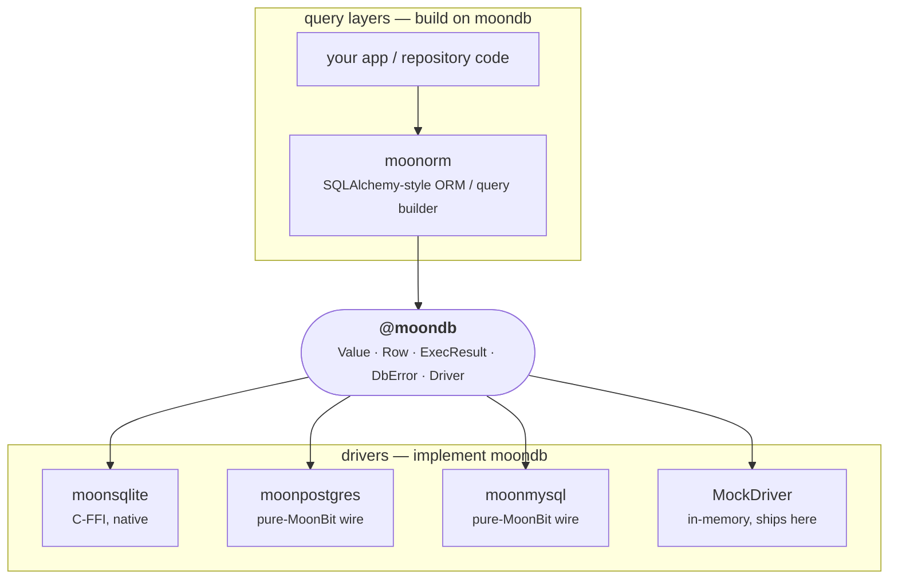

<div align="center">

# moondb

**The standard database-access interface for [MoonBit](https://www.moonbitlang.com/).**

The small, pure contract that sits between database *drivers* and query *layers* — MoonBit's answer to Go's [`database/sql/driver`](https://pkg.go.dev/database/sql/driver) and Python's [DB-API 2.0 (PEP 249)](https://peps.python.org/pep-0249/).

[](https://github.com/moonbitstack/moondb/actions)
[](#tests)
[](https://moonbitstack.github.io/moondb/)
[](https://mooncakes.io/docs/moonbitstack/moondb)
[](LICENSE)

</div>

> Moved on mooncakes from `Lfan-ke/moondb` to `moonbitstack/moondb`.

`moondb` defines **one thing**: the boundary every SQL database backend implements and every ORM / query builder is written against. The interface package has **zero dependencies**, is **pure** (compiles on wasm, wasm-gc, js, and native alike), and ships a dependency-free reference driver so the whole stack above it can be tested without a database. The connection pools live in their own packages — `moonbitstack/moondb/pool` for the synchronous `Driver`, `moonbitstack/moondb/apool` for the async one — so a driver that only implements the interface carries none of the pool's dependencies, and a synchronous driver never pulls in an async runtime.

It deliberately does *not* connect to a database, speak a wire protocol, or build SQL. Those belong on either side of the seam:



The value of a contract package is that the two sides are written by different people at different times and still fit: a driver author implements [`Driver`](#driver) once, and *every* query layer works against their backend; an ORM author targets `Driver` once, and *every* driver works under their ORM.

## Install

```bash
moon add moonbitstack/moondb
```

## The interface at a glance

| Type | Role | Transliterated from |
|---|---|---|
| [`Value`](#value) | one dialect-neutral cell — the unit crossing the boundary both ways | Go `driver.Value`, DB-API type objects |
| [`Row`](#row) | one result row: aligned column names + `Value`s, with typed accessors | `sql.Rows` / DB-API row tuple |
| [`ToValue`, `FromValue`](#your-own-types) | how a MoonBit value binds as a parameter and reads back from a cell; `Row::read` reads any `FromValue` | Go `driver.Valuer` / `sql.Scanner`, Diesel `ToSql` / `FromSql` |
| [`ExecResult`](#execresult) | outcome of a non-query: rows affected + last insert id | Go `sql.Result`, DB-API `rowcount`/`lastrowid` |
| [`DbError`](#dberror) | the one error every operation raises | DB-API exception hierarchy (flattened) |
| [`Driver`](#driver) | the trait a backend implements / a query layer targets (with a default `ping` health probe) | Go `driver.Conn`+`Execer`+`Queryer`+`Pinger` |
| [`@pool.Pool`](pool/) | a fixed-ceiling connection pool over any `Driver`, in `moonbitstack/moondb/pool` | Go `sql.DB` pool, SQLAlchemy `QueuePool` |
| [`@apool.AsyncPool`](apool/) | the same pool for an `AsyncDriver`, where an exhausted acquire really waits, in `moonbitstack/moondb/apool` | `database/sql` waiting, SQLAlchemy `QueuePool(timeout=…)` |
| [`AsyncDriver`](#asyncdriver) | the same contract for a backend reached over a socket, every method awaited | asyncpg / `asyncio` DB-API |
| [`AsyncCursor`](#asyncdriver) | forward-only cursor whose `next` is awaited, for a wire driver's live rows | — |
| [`MockDriver`](#mockdriver) | dependency-free in-memory reference driver, for tests | — |
| [`@blocking.Blocking`](docs/api.html#blocking) | a synchronous driver presented as an `AsyncDriver`, in `moonbitstack/moondb/blocking` | — |
| [`@conformance.Report`](docs/api.html#conformance) | the contract as a case matrix any driver answers, in `moonbitstack/moondb/conformance` | — |
| [`Dialect`](#dialects-and-capabilities) | `Sqlite` / `Postgres` / `Mysql`, and the placeholder each spells | — |
| [`Capabilities`](#dialects-and-capabilities) | what a backend can do beyond the base contract | — |
| [`QueryExecutor`](#the-narrow-view) | the part of a driver that runs SQL, without the part that owns the connection | Go `Queryer` context, SQLAlchemy `Connection.exec_driver_sql` |
| [`Stmt`](#one-statement-many-runs) | a statement prepared once and run with new values, plus `bind_named` | Go `*sql.Stmt`, JDBC `PreparedStatement` |
| [`Txn`](#nested-transactions) | a closure-scoped transaction that nests through savepoints | SQLAlchemy `Session.begin_nested` |

### The binding contract

`execute` and `query` both take `(sql, params)`. The SQL string carries **positional placeholders** and `params` supplies one `Value` per placeholder, **in order**. Values are bound out-of-band by the driver and are **never** spliced into the SQL text — that is what makes a moondb-based stack injection-safe all the way to the wire. All three drivers bind out of band: SQLite through `sqlite3_bind_*`, PostgreSQL through the extended-query protocol, MySQL through `COM_STMT_EXECUTE`.

The placeholder *token* is the driver's dialect (`?` for SQLite/MySQL, `$1`, `$2`, … for PostgreSQL); moondb fixes the *calling convention* — an ordered `Array[Value]` — not the spelling. [`Dialect::placeholder`](#dialects-and-capabilities) spells one, and [`rewrite_named`](#named-parameters) accepts `:name` and produces the right form for whichever backend is underneath.

### Value cases

`Value` is a closed sum every backend maps onto: `Null`, `Bool`, `Int`, `Int64`, `Double`, `Text` and `Blob`, plus `Time` (ISO-8601 text), `Numeric` (exact decimal text, no `Double` rounding), `Uuid` (16 raw bytes), `Json` (JSON text) and `Array` (elementwise, including nested arrays). Temporal values cross the boundary as normalized ISO-8601 text rather than a struct, so this interface package stays dependency-free; a caller parses them with whichever date-time library it likes. The dedicated accessors are `row.time`, `row.numeric`, `row.uuid`, `row.json` and `row.array` (each with a `_by` name variant).

## Quickstart

```moonbit
test "round-trip through the interface" {
  // A query layer is written against the `Driver` trait, not a concrete backend.
  let db = @moondb.MockDriver::new()

  // Bind values as parameters — never string-interpolated into the SQL.
  db.execute("INSERT INTO hero (id, name) VALUES (?, ?)", [Int(1), Text("Nova")])
  |> ignore

  db.begin()
  db.execute("INSERT INTO hero (id, name) VALUES (?, ?)", [Int(2), Text("Iris")])
  |> ignore
  db.rollback() // Iris is undone; Nova remains.

  let rows = db.query("SELECT id, name FROM hero", [])
  assert_eq(rows.length(), 1)
  assert_eq(rows[0].int_by("c0"), 1)
  assert_eq(rows[0].text_by("c1"), "Nova")
}
```

Swap `MockDriver` for `moonsqlite` / `moonpostgres` / `moonmysql` and the same code runs against a real database — that substitutability *is* the point of the package.

## Your own types

`ToValue` and `FromValue` convert between a MoonBit value and a `Value`. They are implemented for the type behind each case (`Bool`, `Int`, `Int64`, `Double`, `String`, `Bytes`), for `Value` itself, and for `T?`, where `None` is `NULL`. `Row::read` and `Row::read_by` read a cell as any `FromValue` type, so a nullable column reads straight into an option:

```moonbit
test "read a nullable column as an option" {
  let row : @moondb.Row = { columns: ["id", "age"], values: [Int(1), Null] }
  let id : Int64 = row.read(0)
  let age : Int? = row.read_by("age")
  assert_eq((id, age), (1L, None))
}
```

A type of the program's own implements both traits to be stored as one of the cases. A refusal is a `TypeError` whose message reads after "column N is":

```moonbit
struct Email(String)

impl @moondb.ToValue for Email with fn to_value(self) {
  let Email(s) = self
  Text(s)
}

impl @moondb.FromValue for Email with fn from_value(v) {
  match v {
    Text(s) if s.contains("@") => Email(s)
    other => raise TypeError(other.kind() + ", not Email")
  }
}
```

## One statement, many runs

`Driver::execute` prepares, binds, runs and discards in one call. A `Stmt` is the handle that survives instead: the server parses and plans once, and each run sends only the values. `bind` replaces them, `execute` and `query` run the statement, `close` releases the server-side resources.

```moonbit
test "one statement, two bindings" {
  let db = @moondb.MockDriver::new()
  let stmt = db.prepare("INSERT INTO hero (id, name) VALUES (?, ?)")
  stmt.bind([@moondb.Value::Int(1), @moondb.Value::Text("Nova")])
  stmt.execute() |> ignore
  stmt.bind([@moondb.Value::Int(2), @moondb.Value::Text("Iris")])
  stmt.execute() |> ignore
  stmt.close()
  assert_eq(db.row_count(), 2)
}
```

All three drivers prepare on the server: SQLite compiles a `sqlite3_stmt`, PostgreSQL sends `Parse` under a cached name, MySQL sends `COM_STMT_PREPARE`. A driver that has nothing server-side to offer still hands out a working handle — the default keeps the text and the values and re-runs the ordinary path.

## Named parameters

`:name` reads better than a column of `?`, and it survives a statement being reordered. `rewrite_named` turns one into the backend's own spelling and records which value each position takes:

```moonbit
test "the same named statement for every backend" {
  let sql = "SELECT * FROM hero WHERE id = :id AND realm = :realm"
  let pg = @moondb.rewrite_named(sql, @moondb.Dialect::Postgres)
  assert_eq(pg.sql, "SELECT * FROM hero WHERE id = $1 AND realm = $2")

  let lite = @moondb.rewrite_named(sql, @moondb.Dialect::Sqlite)
  assert_eq(lite.sql, "SELECT * FROM hero WHERE id = ? AND realm = ?")

  let args : Map[String, @moondb.Value] = Map([])
  args.set("id", @moondb.Value::Int(7))
  args.set("realm", @moondb.Value::Text("north"))
  assert_eq(lite.bind(args).length(), 2)
}
```

The rewrite is a lexer rather than a search-and-replace: a `:name` inside a string literal, a quoted identifier, a `--` / `#` / `/* */` comment or a PostgreSQL `$tag$ … $tag$` body is left alone, a `::` cast and a `:=` argument are not parameters, an array slice `arr[1:3]` is not one either, and mixing `?` with `:name` is refused with the offset that broke it. A repeated name reuses one `$n` on PostgreSQL and repeats its value on the positional dialects, which is what each wire actually allows.

## Nested transactions

`begin` / `commit` / `rollback` are flat, but application code nests: a service opens a transaction, calls a repository method that opens one too, and the inner failure must not discard the outer work. `Txn` brackets a body and derives the savepoint name from the nesting depth, so the pairing cannot be forgotten and two levels never collide:

```moonbit
test "a nested body that fails keeps the outer work" {
  let db = @moondb.MockDriver::new()
  let tx = @moondb.Txn::new(db)
  tx.run(fn(tx) raise @moondb.DbError {
    tx.driver().execute("INSERT INTO hero VALUES (?, ?)", [
      @moondb.Value::Int(1), @moondb.Value::Text("Nova"),
    ])
    |> ignore
    (try {
      tx.run(fn(_tx) raise @moondb.DbError {
        raise @moondb.QueryError("inner failed")
      })
    } catch {
      _ => ()
    })
    |> ignore
  })
  assert_eq(db.row_count(), 1)
}
```

`AsyncTxn` is the same for an `AsyncDriver`, with every round trip awaited.

## Dialects and capabilities

A query layer that has to emit SQL needs two things from the backend: the placeholder spelling, and what the backend can do beyond the base contract. Both come from the driver, so the layer is written once and runs everywhere instead of the caller naming the backend a second time at every call site.

```moonbit
test "ask the driver, not the caller" {
  let db = @moondb.MockDriver::new()
  assert_eq(db.dialect(), @moondb.Dialect::Sqlite)
  assert_eq(db.dialect().placeholder(1), "?")
  let caps = db.capabilities()
  assert_true(caps.savepoints)
  assert_false(caps.streaming_copy)
}
```

`Capabilities` reports prepared statements, named parameters, server-side cursors, streaming `COPY`, savepoints, multiple result sets, unsigned 64-bit integers and `RETURNING` — what the driver in this repository implements, not what the server software could do in principle.

## A blocking driver, seen as an async one

The two driver traits are peers, but an application usually has one backend and one shape of code. A checkpoint store, a retrieval index, a server that runs a single event loop for every dependency — they are all written against `AsyncDriver`, and the database under them may well be a file that answers from the page cache. `@blocking.Blocking` is that seam: every async method calls its blocking twin, and nothing else changes.

```moonbit
async test "a blocking driver behind the async seam" {
  let db = @blocking.Blocking::new(@moondb.MockDriver::new())
  assert_eq(db.dialect(), @moondb.Dialect::Sqlite)
  assert_true(db.capabilities().savepoints)
  assert_true(db.ping())
}
```

Three details are what make it more than a cast. `prepare` hands back the driver's own handle — a `sqlite3_stmt` compiled once — instead of the async default, which would re-run the SQL text on every call. `query_stream` keeps the driver's live cursor, so the memory bound survives. And `dialect`/`capabilities` come from the wrapped driver, so a query layer above sees PostgreSQL as PostgreSQL and not as the seam's SQLite default.

The call runs on the task's own thread, so it occupies the event loop for as long as the driver takes: right for a backend that answers in microseconds out of the page cache, wrong for one that answers in milliseconds over a socket — a networked backend implements `AsyncDriver` itself, where the wait is real. The bridge does not serialise either; give each task its own connection, or park them in an `@apool.AsyncPool`, which hands one connection to one caller at a time.

## The narrow view

A repository method, a query builder, a migration step all want to run SQL; none of them should be able to `close` the connection out from under the caller that lent it to them. `Executor::new(db)` is that narrower handle, and a function that takes `&QueryExecutor` accepts it:

```moonbit
test "a repository only needs to run SQL" {
  let db = @moondb.MockDriver::new()
  fn count(db : &@moondb.QueryExecutor) -> Int raise @moondb.DbError {
    db.query("SELECT 1", []).length()
  }
  assert_eq(count(@moondb.Executor::new(db)), 0)
}
```

## Implementing a driver

A backend implements the `Driver` trait: the four data operations, the three transaction brackets, `close`, and the two introspection methods `dialect` and `capabilities`. `query_stream`, `ping` and `prepare` have defaults, so a minimal driver is short. `DbError` is `pub(all)`, so a driver in its own package can construct and raise every case:

<!-- nocheck -->
```moonbit
pub impl @moondb.Driver for MyConn with fn dialect(_self) { @moondb.Dialect::Sqlite }

pub impl @moondb.Driver for MyConn with fn execute(self, sql, params) {
  // ... bind `params` positionally, run `sql`, then:
  { rows_affected: n, last_insert_id: id }
}
// query / begin / commit / rollback / close likewise.
```

`execute`/`query`/`begin`/`commit`/`rollback` raise `DbError` on failure; `close` is best-effort and idempotent.

## Holding a driver to the contract

A new backend is easy to write and hard to trust. `@conformance` is the contract as a case matrix, written once against the asynchronous seam, so every backend answers the same questions: does `ping` report a live connection, does a bound value read back exactly as it was written — a 64-bit integer, text, a double, bytes with a zero in them, a boolean, a `NULL` — does a prepared handle run twice with new values, does a cursor yield what `query` returns, does a rollback discard the work and a commit keep it, does a savepoint undo exactly one level, and are a duplicate key and a malformed statement classified the way the error model says.

```moonbit
test "a report says what a backend honoured" {
  let report : @conformance.Report = {
    cases: [
      { name: "connection: ping", outcome: @conformance.Outcome::Passed },
      { name: "error: a duplicate key", outcome: @conformance.Outcome::Failed("accepted") },
    ],
  }
  assert_eq(report.summary(), "1 passed, 0 skipped, 1 failed")
  assert_eq(report.failures(), ["error: a duplicate key: accepted"])
}
```

Each case becomes one line in the report, and a failure says what came back instead, so a broken backend produces a list of what is wrong rather than a stack trace at the first problem. A case whose feature the driver reports as absent — savepoints, say — is recorded as skipped with the reason, never counted as a pass. A blocking driver goes through `check_blocking`, which bridges it and exercises the bridge as it goes:

<!-- nocheck -->
```moonbit
let report = @conformance.check_blocking(@moonsqlite.SqliteDriver::open(":memory:"))
assert_eq(report.failures(), [])
```

`Report` counts what passed, failed and was left out, `failures()` returns one line per failure, and `summary()` is one line for a build log.

## Design notes

- **Why raise, not `Result`.** Typed accessors and driver calls `raise DbError` rather than returning `Result[_, DbError]`, so a decode bug or a dropped connection surfaces at the call site instead of being silently swallowed. A caller opts into recovery with `try`/`catch`.
- **Typed accessors are strict.** `row.int(i)` raises `TypeError` if the cell is not an integer — including when it is `NULL`. Read a nullable column as `T?` with `read`, or guard it with `is_null` first. Integer→integer and integer→double conversions are allowed and lossless; `int` narrows an `Int64` and says so.
- **`DbError` is `pub(all)`.** A plain `pub suberror` can be *caught* from another package but not *constructed* — which would stop out-of-tree drivers from raising it. `pub(all)` opens the constructors.
- **`DbError` carries the server's own classification.** Besides `ConnectError` / `QueryError` / `TypeError` / `Closed`, a `Server` case carries a `ServerDetail`: the five-character SQLSTATE, the vendor error number, and the server's message, detail and hint. `DbError::kind()` maps any failure onto a coarse `ErrorKind` (`Integrity`, `Programming`, `Operational`, `Data`, `Internal`, `NotSupported`, …) and `sqlstate()` / `code()` expose the raw fields, so a caller can branch on the class instead of parsing a message.
- **There are two driver traits, on purpose.** `Driver` is synchronous, which is right for a backend whose calls block in C (moonsqlite steps a prepared statement and returns). A backend reached over TCP cannot be written that way: MoonBit's only socket stack is async-only, and an `async fn` cannot be called from a synchronous one. A wire driver forced to conform to `Driver` can do nothing but raise from every method — and because `ping` is a *defaulted* method built on `query`, it swallows that raise into `false`, so a `Pool` with `pre_ping` judges every one of its connections permanently unhealthy. `AsyncDriver` is the seam for those backends: the same eight operations, each awaited. It is a peer of `Driver`, not a replacement — a synchronous backend keeps implementing `Driver` and never becomes async. Declaring async methods pulls in no async runtime, so moondb stays dependency-free and still compiles on every backend; only a driver that implements the trait, and a caller that runs it in an event loop, need one.

- **The pool is synchronous, and its counting is moonpool's.** `@pool.Pool[D]` reuses idle connections under a size ceiling, evicts a connection that fails its `pre_ping` probe or outlives `max_lifetime` (age measured by an injected `clock`, the way `database/sql` swaps `nowFunc` in tests), and offers a non-blocking `try_acquire`. Because moondb's base contract is sync and the pure backends have no threads, an exhausted `acquire` fails immediately rather than blocking — the `acquire_timeout` is the budget an async driver layers real waiting on top of. `ping` is a default `Driver` method (`SELECT 1`), so every driver gets a health probe for free. The bookkeeping underneath — how many are live, which are idle, when each was born — is [moonpool](https://github.com/moonbitstack/moonpool)'s `Pool`, and so is the optional `ward` in front of the database: a backoff after failed connects (`acquire` then raises `ConnectError` until the delay has passed), a token bucket spacing reconnections, a breaker that stops connecting to a failing backend, a shedder. This package adds only opening, closing and probing. It is a separate package because that dependency is the pool's alone: `import { "moonbitstack/moondb/pool" }` where a pool is wanted, and the interface stays dependency-free where it is not.

- **The async pool is where an exhausted acquire actually waits.** `@apool.AsyncPool[D]` is the counterpart for an `AsyncDriver`, and it exists because the synchronous pool cannot do the one thing a full pool is supposed to do. In `@pool.Pool` nothing can return a connection while a caller sits inside `acquire`, so a full pool fails immediately and `acquire_timeout` is only a number in the message. In an event loop, other tasks keep running while one waits — so `AsyncPool` puts the wait on a `Semaphore` with one permit per allowed checkout (`max_size + overflow`) and parks the caller there. `release` returns the permit and wakes exactly one waiter; `acquire_timeout` becomes a real deadline. The bookkeeping is still moonpool's, and `overflow`, `pre_ping`, `max_lifetime` and the `reset` hook mean what they mean in the sync pool — a returned connection is reset before it is reusable, and a connection that came from the overflow allowance is closed rather than idled so the pool settles back to `max_size`. It lives in its own package because it is the one part of moondb that imports `moonbitlang/async`: no synchronous driver reaches it, and the interface package itself still imports nothing. (The module declares the runtime so that package can resolve; a consumer that only wants the interface pays for a download, not for an async dependency in its own build.)

- **The PostgreSQL protocol state machine is testable without a machine.** `PgConn` speaks over a `PgWire`, which is either a socket (plain or TLS-wrapped) or one end of an in-memory pipe pair. That seam is what lets the parts that used to be unreachable — statement sequencing, the streaming guard that refuses a second statement while a `PgRowStream` is open, draining the rest of a result after an `ErrorResponse`, the COPY sub-protocol, notifications, the statement cache — run against a scripted peer in a unit test, byte for byte, with no server and no network. The live integration suites still exist and still run against real TLS-enabled servers; the offline tests are what catch a regression on a laptop with no database.

## What each driver supports

| | SQLite | PostgreSQL | MySQL |
|---|:--:|:--:|:--:|
| Prepared `Stmt` | yes | yes, with a statement cache | yes |
| Named parameters | yes | yes | yes |
| Server-side cursor | no | yes, `DECLARE`/`FETCH` in batches | no |
| Streaming `COPY` | no | yes, both directions | no |
| Savepoints | yes | yes | yes |
| Multiple result sets | no | yes | yes |
| Unsigned 64-bit | no | no | yes |
| `RETURNING` | yes | yes | no |
| Binary result format | — | opt-in, per column | prepared statements |
| Long parameters (streamed) | — | — | yes, past 1 MiB |

Each driver's CI also runs the shared conformance matrix against servers of a different lineage that speak the same wire protocol — CockroachDB for PostgreSQL, TiDB for MySQL — and each driver's README lists the SQL differences those servers bring. A backend outside this repository reports its own through `Driver::dialect` and `Driver::capabilities`; a capability reported false is a plan the query layer lowers, not an error it discovers mid-statement. Binary results and streamed parameters are driver-level choices rather than contract ones: they change how a value crosses the wire, not what the trait can express, so each driver exposes them on its own calls.

## Tests

The conformance matrix runs against real PostgreSQL, MySQL, MariaDB, CockroachDB and TiDB in CI; SQLite has its own native suite. The suite covers the value model, every typed accessor and its error path, the error type, the reference driver — including real transaction rollback/commit semantics and savepoint scope — both connection pools, the `:name` lexer (literals, identifiers, comments, dollar quotes, casts, JSONB operators, mixed conventions), the statement handles, and the PostgreSQL protocol state machine driven off-machine over an in-memory wire: statement sequencing, the streaming guard, the post-error drain, the prepared handle, the server-side cursor and the COPY sub-protocol. Key behaviours are mutation-verified: breaking `rollback` turns the transaction tests red; breaking the savepoint rollback scope turns the nested-transaction tests red; breaking the dollar-quote lexing turns the named-parameter tests red; disabling the pool's `pre_ping` eviction or its `max_lifetime` retirement turns the corresponding pool tests red; dropping the `PgRowStream` guard, the post-error drain or the statement cache turns the offline protocol tests red; dropping the bridge's `prepare` delegation turns its statement test red; and not recording a binary result's column types turns the second-call test red. They run on all four backends:

```bash
moon test --target all
```

## License

Apache-2.0 © Leo Cheng
