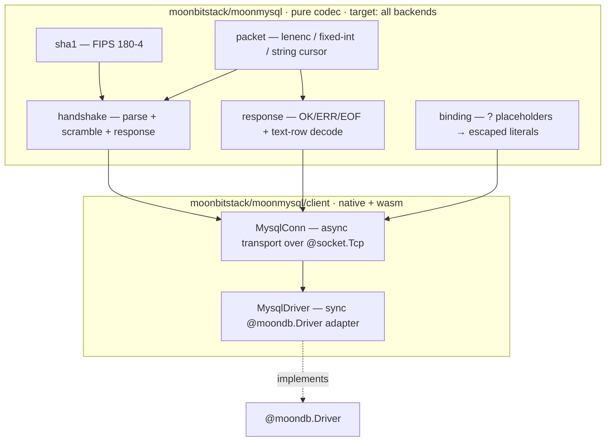

# moonmysql

> Moved on mooncakes from `Lfan-ke/moonmysql` to `moonbitstack/moonmysql`.

A **pure-MoonBit MySQL / MariaDB wire-protocol driver** — no C, no bindings, like
PyMySQL. It speaks the MySQL client/server protocol (version 10 handshake,
`mysql_native_password` / `caching_sha2_password` / MariaDB `client_ed25519` auth,
the text `COM_QUERY` protocol and the binary prepared-statement protocol) directly
over a raw socket, and implements the [`@moondb.Driver`](https://github.com/moonbitstack/moondb)
contract so a moondb-based query layer (moonorm) can talk to MySQL through the
same seam as the SQLite and Postgres drivers.

**MariaDB** speaks the same wire protocol and is a first-class target: the
handshake parser recognises MariaDB's `5.5.5-` version sentinel (recovering the
real version and reporting `server_kind = MariaDB`), reads past its extended
capability bits without disturbing the MySQL-8 offsets, and authenticates over
the shared `mysql_native_password` path. CI runs the *same* integration suite
against MySQL 8, MariaDB 11, and MariaDB 10.11.

```
$ moon add moonbitstack/moonmysql
```

Previously published as `Lfan-ke/moon-mysql`.

- **API reference:** https://moonbitstack.github.io/moonorm/mysql/
- **License:** Apache-2.0

## Quickstart

The synchronous `@moondb.Driver` adapter is the one-call-per-statement surface:

```moonbit
let db = @client.MysqlDriver::new(
  user="root", password="root", database="test",
  host="127.0.0.1", port=3306,
)
db.execute("CREATE TABLE t (id INT PRIMARY KEY, name TEXT)", [])
db.execute("INSERT INTO t VALUES (?, ?)", [@moondb.Int(1), @moondb.Text("a")])
let rows = db.query("SELECT id, name FROM t", [])
rows[0].int_by("id")   // => 1
rows[0].text_by("name") // => "a"
```

For long-lived connections and real transactions, use the asynchronous
`MysqlConn` directly (see [The async wall](#the-async-wall) below):

```moonbit
async fn run() -> Unit raise {
  let conn = @client.MysqlConn::connect("127.0.0.1", 3306, "root", "root", "test")
  conn.begin()
  conn.execute("INSERT INTO t VALUES (?, ?)", [@moondb.Int(2), @moondb.Text("b")])
  conn.commit()
  let rows = conn.query("SELECT * FROM t", [])
  conn.close()
}
```

## Architecture

The library is split so the entire wire format is testable off any backend. The
socket transport supports native and wasm; wasm runtime use requires a host with
TCP socket bindings, such as moonrun, and does not include browser wasm.



```
%% root (pure, all backends)          client (native + wasm host)
%%   sha1 ─┐                            MysqlConn ── async socket transport
%%   packet┼─ handshake ─┐                 │
%%         └─ response ──┼──────────────►  │
%%            binding ───┘              MysqlDriver ── impl @moondb.Driver
```

Every packet field type — the 3-byte length + sequence-id framing, length-encoded
and fixed-width little-endian integers, NUL- and length-encoded strings — is
parsed through an in-memory cursor in the pure half, so the codec is unit-tested
on wasm, wasm-gc, js, and native. The `client` package adds the async socket
transport and the driver. It compiles on native and wasm; wasm execution requires
host-provided TCP socket bindings (verified with moonrun), so browser wasm is not
a supported runtime.

## The async wall

`moonbitlang/async` sockets are asynchronous, but `@moondb.Driver`'s methods are
synchronous, and MoonBit forbids calling an `async` function from a non-`async`
one. The synchronous adapter bridges each call through `@async.run_async_main`,
which runs an async body to completion on a fresh event loop.

A socket does **not** survive across two such event loops (each tears its file
descriptors down — verified empirically), so the synchronous `MysqlDriver` opens
a fresh connection, authenticates, runs one statement, and closes, on every
`execute`/`query`. This is correct and efficient enough for autocommit work
(which is exactly what a moondb roundtrip is), but it means a transaction cannot
be held open across separate `Driver` calls. `begin`/`commit`/`rollback` on the
synchronous adapter therefore raise a clear `DbError` directing you to the
asynchronous `MysqlConn`, which owns its socket for its whole lifetime and
brackets real server-side transactions. This is a language constraint, not a
shortcut.

## Injection safety

Values never reach the server as SQL text unescaped. A statement with parameters
goes over `COM_STMT_PREPARE`/`COM_STMT_EXECUTE`, where the values travel in the
binary protocol and the SQL text is never built — the server has already parsed
it. The text protocol is used only for a statement with no parameters.

## Prepared statements

`MysqlConn::prepare` sends `COM_STMT_PREPARE` and returns an `@moondb.AsyncStmt`:
`bind` sends new values, `execute`/`query` run the statement, `close` sends
`COM_STMT_CLOSE`. A `:name` statement is rewritten to `?` at prepare time and the
slot names are kept, so `bind_named` takes a map.

The binary protocol's row decoder reads the column flags word: an `INT UNSIGNED`
above 2^31-1 comes back as `Int64` rather than a negative `Int`, and a
`BIGINT UNSIGNED` above 2^63-1 keeps its exact digits as `Text`.

## Long parameters

A parameter of one mebibyte or more is not carried inside `COM_STMT_EXECUTE`. It is
streamed first, in `COM_STMT_SEND_LONG_DATA` packets of one mebibyte each; the execute
packet that follows still declares its type — the server needs to know how to read the
buffered bytes — but does not repeat the value. The server appends the pieces in order
and answers none of them, so a streamed statement still costs one round trip.

```moonbit
async fn store(conn : @client.MysqlConn, id : Int, raw : Bytes) -> Unit raise {
  // A 40 MB blob: four long-data packets, then a one-packet execute.
  conn.execute("INSERT INTO asset VALUES (?, ?)", [
    @moondb.Int(id), @moondb.Blob(raw),
  ])
  |> ignore
}
```

No call site decides this: the driver does, by size, for every parameter of every
prepared statement — so `execute`, `query`, a prepared handle and the internal paths all
behave the same way. `@moonmysql.long_data_chunk` is the number, one mebibyte, and it is
both the threshold and the packet size.

Why it exists: `max_allowed_packet` caps a single packet — 64 MiB on MySQL 8 and 16 MiB
on MariaDB by default — and an execute packet holds every parameter at once. A value near
that cap is un-sendable inline, however it is encoded; chunked, each packet is one
mebibyte and the limit stops applying to the value itself.

## Type mapping (text protocol)

| MySQL column type | `@moondb.Value` |
|---|---|
| `TINYINT` / `SMALLINT` / `INT` / `MEDIUMINT` / `YEAR` | `Int` |
| `BIGINT` | `Int64` |
| `FLOAT` / `DOUBLE` | `Double` |
| `binary`-collation columns (`BLOB`, `VARBINARY`, …) | `Blob` |
| `VARCHAR` / `TEXT` / `DECIMAL` / `JSON` / temporal (ISO text) | `Text` |
| SQL `NULL` | `Null` |

## Tested against a real MySQL and MariaDB

CI (`.github/workflows/ci.yml`) starts a real **MySQL 8** (pinned to
`mysql_native_password`) and, in separate jobs, **MariaDB 11** and **MariaDB
10.11**, then runs `moon check`/`build`/`test` on native against each. The
integration tests — gated by `MYSQL_TEST` so a local `moon test` without a database
skips them — connect, authenticate, create tables, insert parameter-bound rows
(integers, UTF-8 text, an embedded quote), and assert the decoded result sets cell by
cell; the same suite is green on all three servers. Among them:

- **Protocol parity** — one table of twenty column types, read once with `COM_QUERY`
  and once through a prepared statement, compared value by value, so the protocol a
  caller happens to take cannot change what it reads.
- **Long parameters** — a blob and a text value above one mebibyte inserted through a
  prepared statement, then read back over both protocols and compared byte for byte,
  next to a parameter just under the threshold that stayed inline.

The pure codec additionally runs on every backend, and `parse_server_version`
has a unit test covering both MariaDB's `5.5.5-` sentinel and a plain MySQL
version string.

## Consistency

Every column type reads the same through the text and the binary protocol, with one
exception the server causes and no client can paper over: a **`FLOAT`** column. MySQL
renders `float` with six significant digits in the text protocol (`1.23457`) and sends
all four bytes in the binary one, so the two paths carry different doubles for the same
stored 32-bit value. It is pinned by a test rather than smoothed over: read `FLOAT`
through a prepared statement, or use `DOUBLE`, when the exact 32-bit value matters.

### Authentication

- **`mysql_native_password`** — SHA1 scramble, and the down-negotiation a MariaDB
  server may ask for through `AuthSwitchRequest`.
- **`caching_sha2_password`** — MySQL 8's default. The fast path uses the cached
  SHA256 scramble; a cold cache triggers full authentication, where the password
  is XOR-ed with the nonce and sealed with RSA-OAEP under the server's public key.
  Over TLS the credential goes in the clear, which is what the protocol specifies.
- **`client_ed25519`** — MariaDB's plugin: the 32-byte nonce is signed with the
  password-derived Ed25519 secret, and a wrong signature fails the login. CI
  creates an ed25519 account and authenticates through it.
- **TLS** — `MysqlDriver::new(tls=…)` / `MysqlConn::connect(tls=…)` swap the
  transport after the greeting; the `SSLRequest` and the handshake response carry
  the same capability word.

Any other plugin raises a clear `UnsupportedError` rather than silently
mis-authenticating.

### Result sets, charsets, unsigned columns

One statement may answer with more than one result set — a stored procedure's
`CALL` does. `MysqlConn::query_multi` returns every set in the order the server
sent them; the single-result path drains the rest so the connection stays in step.
`CLIENT_MULTI_RESULTS` and `CLIENT_MULTI_STATEMENTS` are advertised for this.

The connection charset is the `charset` parameter of `connect` (a collation id,
`45` = `utf8mb4_general_ci` by default). A charset whose trailing byte can be
`0x5C` (`gbk`, `big5`, `sjis`, `cp932`, `gb18030`) is refused when escaping would
be load-bearing, because a backslash there can continue a multibyte character.

## Not covered

- **`sha256_password`** — MySQL's older RSA plugin, superseded by
  `caching_sha2_password` and not a default anywhere current.
- **Compressed protocol** and the **X protocol**. Neither changes what a query
  layer can ask for.
- **`LOAD DATA LOCAL INFILE`**. It is disabled on most servers; `COPY`-style bulk
  loading goes through prepared statements here.

## Parameter binding

The text protocol has no out-of-band binding, so `bind_params` renders each value as
an escaped literal. That makes the escaping load-bearing rather than cosmetic: a
connection asks the server for `@@sql_mode` and `@@character_set_connection` at
connect time and escapes for what it finds — a doubled quote under
`NO_BACKSLASH_ESCAPES`, a backslash otherwise. A charset whose characters can end in
`0x5C` (gbk, big5, sjis, cp932, gb18030) cannot be escaped safely with backslashes at
all, so such a connection is refused rather than served.

A statement with parameters never takes that path: it goes over
`COM_STMT_PREPARE`/`COM_STMT_EXECUTE`, where the values travel in the binary protocol
and the SQL text is never built.
