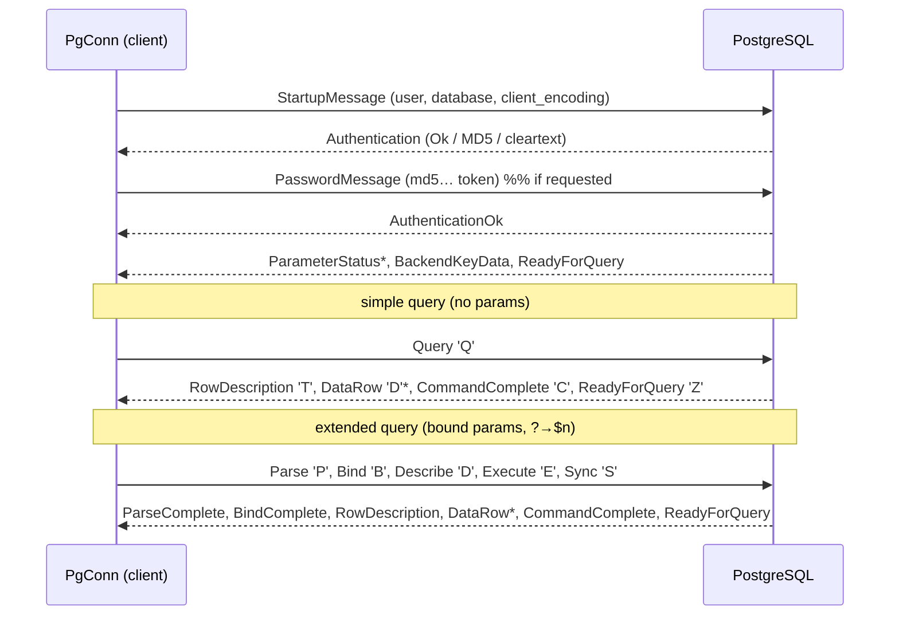

# moonpostgres

> Moved on mooncakes from `Lfan-ke/moonpostgres` to `moonbitstack/moonpostgres`.

A **pure-MoonBit PostgreSQL driver** — the v3 frontend/backend wire protocol spoken directly over async TCP, with **zero C** and no `libpq`. Like [asyncpg](https://github.com/MagicStack/asyncpg) or [pg8000](https://github.com/tlocke/pg8000), it talks to a real PostgreSQL server itself. `PgConn` implements the [`@moondb.AsyncDriver`](https://mooncakes.io/docs/moonbitstack/moondb) contract, so a moondb-based stack (e.g. `moonorm`) can sit on top of it.

```
moon add moonbitstack/moonpostgres
```

Previously published as `Lfan-ke/moon-postgres`.

Supports native and wasm hosts with TCP socket bindings, such as moonrun. Browser
wasm is not supported because it cannot open raw TCP sockets.

## Quickstart

The real driver is the async `PgConn` (asyncpg-shaped), used inside an event loop (`async fn main` / `async test`):

```moonbit
async fn run() -> Unit raise {
  let conn = @moonpostgres.PgConn::connect(
    "127.0.0.1", 5432, "postgres", "postgres", "test",
  )
  conn.execute("CREATE TABLE hero (id int, name text)", []) |> ignore

  // '?' placeholders are translated to '$1','$2' and bound out-of-band
  // (never spliced into the SQL) — injection-safe to the wire.
  conn.execute("INSERT INTO hero VALUES (?, ?)", [
    @moondb.Int(1), @moondb.Text("Boromir"),
  ]) |> ignore

  let rows = conn.query("SELECT id, name FROM hero WHERE id = ?", [@moondb.Int(1)])
  println(rows[0].text_by("name")) // Boromir

  conn.begin()
  conn.execute("UPDATE hero SET name = ? WHERE id = ?", [
    @moondb.Text("Faramir"), @moondb.Int(1),
  ]) |> ignore
  conn.commit()

  conn.close()
}
```

## What it speaks



- **Framing** — every message is a 1-byte type tag, a big-endian `Int32` self-inclusive length, and a payload (the untagged StartupMessage aside).
- **Auth** — `AuthenticationOk` (trust), cleartext, **MD5** (`md5(md5(password+user)+salt)`, pure MoonBit), and **SCRAM-SHA-256**: SASLprep over the password (RFC 4013), the `SCRAM-SHA-256-PLUS` variant with channel binding when the server offers it, and server-signature verification so a peer that cannot prove it knows the stored key is rejected. TLS is negotiated with `SSLRequest`; a server that answers `N` is an error, never a silent downgrade.
- **Simple query** (`Q`) when there are no parameters; **extended query** (`Parse`/`Bind`/`Describe`/`Execute`/`Sync`) when there are, with `?`→`$n` translation and out-of-band **text-format** binding.
- **Decoding** — `RowDescription` + `DataRow` decode into `@moondb.Row` by column type OID: `int2`/`int4`→`Int`, `int8`→`Int64`, `float4`/`float8`→`Double`, `bool`→`Bool`, `bytea`→`Blob`, `numeric`→`Numeric`, `uuid`→`Uuid`, `json`/`jsonb`→`Json`, the date/time types→`Time`. An OID the table does not know — an enum or a domain — reads as `Text`, which is what asyncpg does.
- **Result format** — text by default, binary for the columns whose binary form is exact when the caller asks for it (see [Binary results](#binary-results)).
- **Prepared statements** — `Parse` under a generated name, cached by SQL text, so a repeated statement binds instead of re-parsing; `prepare` hands that handle out as `@moondb.AsyncStmt`.
- **Cursors** — `DECLARE`/`FETCH`/`CLOSE` as a `PgCursor` that pulls a batch per round trip, plus `PgRowStream` for one statement's response read off the wire.
- **COPY** — both directions streamed: `copy_in_stream` writes one chunk per call, `copy_out_stream` reads one, and neither holds the payload.
- **Session** — `LISTEN`/`NOTIFY`, `ParameterStatus` tracking, `CancelRequest` on a second connection.

## Binary results

A result is text unless you ask for the other format. `binary=true` on `query`,
`query_stream` or `prepare_stmt` fetches each column in PostgreSQL's **binary** format —
chosen per column from its type, so one row can carry both:

```moonbit
let rows = conn.query("SELECT id, name, at FROM hero", [], binary=true)
```

The choice is made where the binary form carries exactly what the text form carries, so the
format a caller picks cannot change the value it reads back. Binary for `bool`, `bytea`,
`int2`, `int4`, `int8`, `float8`, `text`, `varchar`, `char`, `name`, `json`, `jsonb`,
`uuid`, `date`, `time`, `timetz`, `timestamp`, `numeric`, and arrays of those. Two types
stay text however you ask:

| Type | Why it stays text |
|---|---|
| `float4` (`real`) | Text is the shortest decimal that round-trips the 32 bits (`1.1`); binary widens to the double nearest those bits (`1.100000023841858`). Reading one column two ways would give two numbers. |
| `timestamptz` | Binary is an absolute instant in UTC; text is that instant rendered in the session's `TimeZone`. Reproducing the text form needs the server's zone database here. |

An OID with no binary decoder — an enum, `interval`, `money`, an extension type — is read as
text and decodes to `Text`, exactly as in text mode. A domain reports its base type's OID,
so it reads as that type.

Binary costs one extra round trip per call: the column types have to be described before the
`Bind` can name a format code for each. A prepared handle describes once, at `prepare`, and
pays nothing per run:

```moonbit
let stmt = conn.prepare_stmt("SELECT id, payload FROM event WHERE id = ?", binary=true)
@moondb.AsyncStmt::bind(stmt, [@moondb.Int(7)])
let rows = @moondb.AsyncStmt::query(stmt)
```

Both formats are checked against each other: one statement over 55 columns of every mapped
type runs in text and in binary against a real server in CI, and every cell is compared
value by value.

## Why the driver is async

`@moondb.Driver`'s methods are **synchronous** (`fn execute(...) raise DbError`), which fits an FFI-backed driver like `moonsqlite` whose C calls block. PostgreSQL is reached over TCP, and MoonBit's only socket stack (`moonbitlang/async`) is **async-only**: an `async fn` cannot be called from a synchronous one, and the runtime exposes no public "run this async thunk to completion" bridge (`with_event_loop` lives in an import-blocked `internal` package). A synchronous method therefore cannot perform a PostgreSQL round trip.

That is why moondb has a second seam. **`PgConn` implements [`@moondb.AsyncDriver`]** — the same eight operations as `Driver`, every one of them awaited — and `PgDriver` is now just the connection descriptor you open one from. Use it inside an event loop (`async test` / `async fn main`):

```moonbit
async fn main {
  let conn = PgDriver::new(host="127.0.0.1", user="postgres", database="app").connect()
  defer conn.close()
  let drv : &@moondb.AsyncDriver = conn
  let rows = drv.query("SELECT id, name FROM users WHERE id = ?", [@moondb.Int(1)])
}
```

Before this, `PgDriver` implemented the *synchronous* `Driver` by raising from every row-touching method. That was worse than useless in one specific way: `ping` is a defaulted method built on `query`, so it swallowed the raise and returned `false`, and any `Pool` with `pre_ping` judged every connection permanently unhealthy. The raising façade is gone.

This is the language-idiomatic equivalent, not a shortcut: asyncpg is async for exactly the same reason.

## Testing

- **Unit** (`moon test`) — MD5 vectors, `?`→`$n` translation (literals/identifiers/comments/dollar-quotes/`??`), value encode/decode by OID in both formats (integers, floats, `numeric` at several scales, dates with their era suffix and infinities, times, `timetz` zones, arrays with NULL elements and nesting), and message framing + `RowDescription`/`DataRow` decode against synthetic backend messages.
- **Off-machine** — the same state machine over an in-memory pipe with a scripted peer: the statement cache, the streaming guard, the post-error drain, the prepared handle, `Close` reclaiming a statement, the server-side cursor, `COPY` in and out chunk by chunk, and the two batches a binary result sends (the `Describe` that names the types, then the `Bind` whose format codes are checked byte for byte).
- **Integration** (`moon test`, gated on `MOON_PG_TEST`) — connect / DDL / parameterised INSERT / SELECT round trip, transactions, savepoint scope, cursors, prepared handles and a 100 MB `COPY` in and out against a **real PostgreSQL**, plus the binary-vs-text parity matrix. Skipped when `MOON_PG_TEST` is unset (local checkout without a database); CI stands up a `postgres:16` service and runs it. Connection parameters come from the standard `PGHOST`/`PGPORT`/`PGUSER`/`PGPASSWORD`/`PGDATABASE` variables.

The `DataRow` decoder is mutation-checked: breaking it makes the decode test fail with a type error. So is the format choice — declaring `float4` binary turns the parity matrix red on the first row.

## Servers that speak this protocol

PostgreSQL is not the only server that answers it. The driver's CI runs the shared
[conformance matrix](https://moonbitstack.github.io/moondb/guide.html#conformance) —
connect, bind and read back, prepare, transact, nest through a savepoint, every column
type, and the classification of two failures — against a real **CockroachDB v24.3** and
a real **openGauss 7.0**, as well as against PostgreSQL 16. All twelve cases pass on all
three. Nothing below the SQL layer is PostgreSQL-specific: the startup handshake, the
extended-query protocol, the binary formats and the error mapping are what the wire
protocol defines.

What differs is the SQL on top, and each server's own suites name it — which is why
those suites run against PostgreSQL only.

### CockroachDB

- **`LISTEN` / `NOTIFY`** — not implemented; the server answers `syntax error at or near
  "listen"`. A query layer that depends on notifications has to poll instead.
- **`DROP TYPE … CASCADE`** — not implemented, which is enough to fail a type-matrix
  fixture that uses it.
- **Queries** `DECLARE`/`FETCH` and `COPY (…) TO STDOUT` do work; `COPY … FROM` and a
  notify stream would not.

### openGauss

- **Authentication.** openGauss hashes passwords with its own algorithms. With
  `password_encryption_type = 0` (MD5) this driver authenticates as it does against
  PostgreSQL; the default `2` (SHA-256 only) and `3` (SM3 only) are answered with an
  authentication request this driver does not implement, and the connection is refused.
  Set it with `gs_guc reload -N all -I all -c "password_encryption_type=0"` and reset the
  role's password, or run the server with the value already at `0`.
- **`ON CONFLICT … DO UPDATE`** — not implemented (`syntax error at or near "CONFLICT"`);
  an upsert needs `MERGE INTO` or a delete-then-insert.
- **`DOMAIN`** — not implemented (`DOMAIN is not yet supported`), so a domain column cannot
  be read at all, not even as text.
- **`LISTEN` / `NOTIFY`** — not implemented (`LISTEN statement is not yet supported`).
- **An empty string is stored as `NULL`.** openGauss does not distinguish `''` from
  `NULL`, so `Text("")` does not round-trip; read such a column as `T?` and do not rely
  on telling the two apart.
- **`BackendKeyData`'s pid is not `pg_backend_pid()`.** A pool that identifies a reused
  connection by that pid (this driver's own pool test does) has to identify it another
  way against openGauss.
- **`capabilities()`** describes this driver, not the server in front of it. It reports
  `streaming_copy`, `server_cursors` and `multiple_result_sets` true because the
  PostgreSQL implementation has them; `COPY` and cursors work on openGauss, but the three
  statements above do not.

## Not covered

- **Pipeline mode** (PostgreSQL 14+). The wire seam already speaks one message batch at a time; batching independent statements would be a latency optimisation, not a capability.
- **Logical replication** and `COPY BOTH`. The copy sub-protocol here is client-side in and out.
- **Large objects** (`lo_*`). Use `bytea` or the copy path instead.

## License

Apache-2.0 © Leo Cheng.
